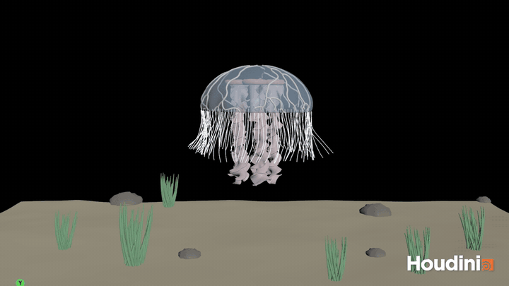

# HW 3: Procedural Jellyfish

Ximing Luo, CIS 5660

A moon jellyfish made in Houdini. The bell is modeled and keyframed, and every other part either follows it through a point deform or gets simulated with Vellum and pinned to it.

## Parts

**Bell.** A line is bent twice, revolved into a dome, and finished with fuse, mountain noise and an extrude. Keyframes on a controller null drive the two bends and the vertical motion so the bell closes, sinks and pushes back up.

**Arms.** A skinny grid is ruffled with a point wrangle, twisted three turns and remeshed, then copied five times around with the top row as the pin group. A point deform on the bell centroid moves the arms with the bell, and Vellum cloth with stiff stretch, soft bend and low gravity makes them drift.

**Veins.** The rest bell is remeshed into triangles with a random cost per point, and a find shortest path node from random rim points to the top gives a branching tree. The paths are resampled, fused, smoothed, swept into tubes and point deformed onto the bell.

**Organs.** An open arc offset so its gap faces the middle is copied four times at 90 degrees, roughed up with mountain noise and swept into a capped tube. The bell gets an Alpha of 0.5 so they show through.

**Tentacles.** Following the Vellum hair tutorial, a short line is copied to each point on the bottom row of the bell, and Vellum hair with a pin to target on the roots keeps them attached while a POP force adds sway.

## Extra credit

**Scalloped bell.** A short wrangle scales each point by a sine wave of its angle around the dome, faded out toward the top, plus some noise for dents.

**Mouth tube.** A line is swept into a tube that flares at the bottom and sits between the arms where the manubrium would be.

**Seafloor.** A grid pushed into dunes with a mountain node, rocks copied onto scattered points, and sea grass tufts made from bent lines swept into thin tubes and rayed onto the sand.
